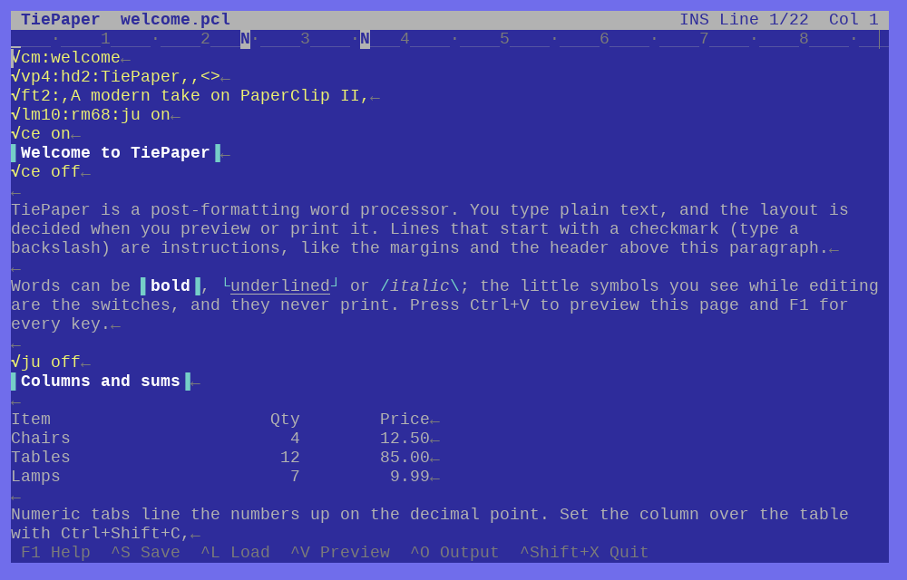
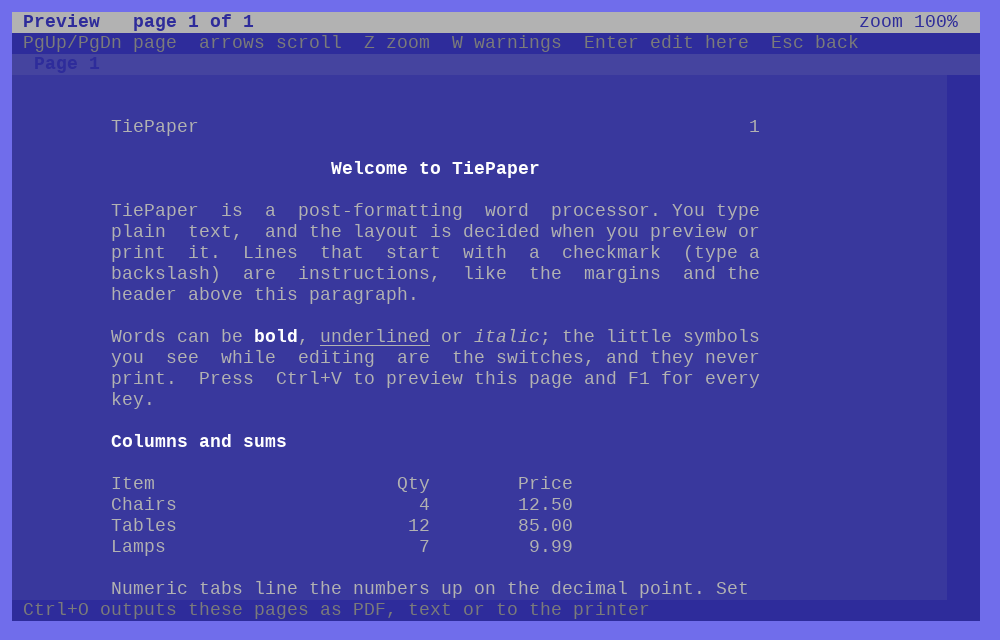

# TiePaper

A modern take on **PaperClip II**, the Batteries Included word processor for the
Commodore 128/64, for Linux and Windows.

TiePaper is a *post-formatting* word processor. You type plain text; the screen
shows exactly what you typed. Layout instructions live in the text, on lines that
start with a checkmark, and are carried out when you **preview** (Ctrl+V) or
**output** (Ctrl+O). That is how the original worked, and it is what makes it fast,
keyboard-driven and good with tables.





## What it keeps from PaperClip II

- Format lines (`✓lm10:rm70`, `✓ju on`, `✓hd2:Title,,<>` ...), embedded print marks
  (underline, bold, italics, super/subscript, hard space, conditional hyphen, breakpoint)
- The tap-or-hold **Control** command keys, with the manual's bindings
- Line ranges (set, transfer, copy, delete, erase, save), phrases, 52 instant phrases
- Columns: move, shift, repeat, insert, delete, erase, **add** (38-digit arithmetic),
  **sort** by up to 16 fields, numeric tabs that line numbers up on the decimal point
- Find, hunt, and search and replace (up to five pairs, wild cards, across linked files)
- Headers, footers, page and chapter numbers, forced paging, automatic indent
- Linked files (`nx:`, `lk`, `ex:`), table-of-contents files (`tf:` / `tb`), unformat
- The tab line (a ruler that doubles as the prompt line) and the status line
- Screen options menu with the C64 colours, including the preview colours for each
  combination of bold / underline / italics

## What is new

- Resizable window; the line length follows the window (or is fixed per document)
- Unicode text (accents, €, curly quotes) and a real TTF font
- **PDF output** for printing and sharing, plus plain text, plus your system printer
- **Spell check** (Ctrl+Shift+Y) through the OS: hunspell/aspell/enchant on Linux, the built-in checker on Windows
- Select text with Shift+arrows or the mouse (drag, double-click a word, Alt+A for all), then type, delete, copy or make it bold
- Bold, italics and underline shown live in the editor, on Alt+B / Alt+I / Alt+U (Ctrl+B too)
- Undo/redo, system clipboard (Alt+C / Alt+X / Alt+V), mouse positioning and wheel
- Asks before discarding changes; saves through a temporary file and keeps a `.bak`

## Not included

SpellPack's own dictionary (spelling uses the system checker instead, Ctrl+Shift+Y), form letters / mail
merge, telecommunications, disk-drive commands, sequential data files, and printer
files (output goes through PDF instead). The checkmark `✓ep:` raw-printer-file link is
reported as unsupported.

## Running it

Linux needs SDL2 and SDL2_ttf (`pacman -S sdl2 sdl2_ttf`). On Windows, `SDL2.dll` and
`SDL2_ttf.dll` must sit next to `tiepaper.exe`; `./fetch-windows-dlls.sh` downloads the
official ones (SDL2 2.32.10, SDL2_ttf 2.24.0) into `build/win/` and checks their hashes.
Those are the only two DLLs needed. The program loads them at run time, so there is no
build-time dependency on SDL.

Not yet verified: the editor has been driven headlessly on Linux and under wine (with the
official DLLs), but not on a real Windows machine; the Windows exe is not DPI-aware, so text
may look soft at display scaling above 100%. Printing goes through `lp` on Linux and the
shell's print verb on Windows; use PDF output if either misbehaves.

```
tiepaper [file]                   start the editor
tiepaper --pdf in out.pdf         format a document to PDF, no window
tiepaper --text in out.txt        format to plain text, no window
```

Press **F1** for the built-in key reference, or read [docs/keys.md](docs/keys.md) and
[docs/format-lines.md](docs/format-lines.md).

A first document:

```
✓lm10:rm70:ju on
✓vp4:hd2:My Report,,<>
✓ft2:,,Page <>
Type your text here. Paragraphs end where you press Return.
```

Type a backslash (`\`) at the start of a line to get the checkmark.

## Building

```
./build.sh            # Linux, builds build/tiepaper with FPC 3.2.2
./build-windows.sh    # cross-compiles build/win/tiepaper.exe (needs the win64 units)
./fetch-windows-dlls.sh   # puts the official SDL2 DLLs beside it
```

Fonts are in `fonts/` (Liberation Mono, SIL Open Font License, see
`fonts/LICENSE-Liberation.txt`). To use another monospaced TTF family, put
`Name-Regular.ttf`, `-Bold`, `-Italic`, `-BoldItalic` in that folder and set the font
name in File Options (F4); a C64-style font works well.

Settings live in `~/.config/tiepaper/tiepaper.ini` (the tiepaper folder under your app-data folder on Windows). The first run copies settings over from the old `paperclip` folder if there is one.

## Icon and menu entry

The icon (`assets/tiepaper.svg`) is compiled into the program: it is the icon of `tiepaper.exe`
on Windows and the window icon on both systems. On Linux, `./install-desktop.sh` adds TiePaper
with its icon to your application menu (`--uninstall` removes it again). `assets/make-icons.sh`
regenerates the PNG, ICO and resource files from the SVGs; the results are committed, so
building needs none of its tools.

## Third-party software

TiePaper loads SDL2 and SDL2_ttf at run time; the Windows installer and the AppImage ship them.
SDL2_ttf includes FreeType and HarfBuzz. Their licences are in `assets/licenses/` (and in the
`licenses` folder of the installed program). Portions of this software are copyright (c) The
FreeType Project (www.freetype.org). All rights reserved.

## Tests

```
tests/run-tests.sh          # document model, formatter, search, columns, PDF (133 checks)
tests/run-tests.sh win      # the same, cross-compiled and run under wine
tests/run-gui-tests.sh      # drives the real editor headlessly (SDL dummy driver)
python3 tests/fuzz.py 50 1  # random keystrokes against a range-checked build
```

The GUI tests replay scripts from `tests/scripts/` (`key ctrl+r`, `text hello`, `shot x.bmp`,
`dump file.txt` ...) and compare the resulting text with `tests/expected/`.

## Source layout

| File | Role |
|------|------|
| `src/pcdoc.pas` | Document model: paragraphs, wrapping, marks, undo, files |
| `src/pcfmt.pas` | Output formatter: format lines, pages, headers/footers, links |
| `src/pcout.pas` | PDF and plain-text writers |
| `src/pcsearch.pas`, `src/pccolumns.pas`, `src/pcspell.pas` | Search patterns; column functions and arithmetic; the system spell checker |
| `src/pcsdl.pas`, `src/pcgfx.pas` | Run-time SDL2 bindings; the character-cell display |
| `src/pcapp*.inc`, `src/pcapp.pas` | The editor: input, drawing, editing, blocks, search, files, screens |
| `assets/` | The icon: SVG sources, PNG/ICO files, the compiled resource, `.desktop` file |
